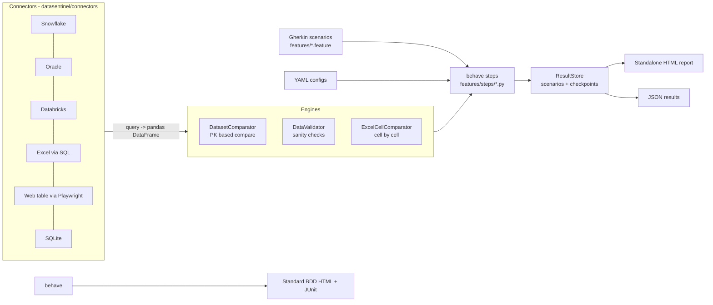

# 1. Overview and architecture

## What is DataSentinel?

DataSentinel is a **BDD test framework** (Python + [behave](https://behave.readthedocs.io)) for proving that
data is correct wherever it lives and however it is displayed. It does four jobs, all written as plain-English
Gherkin scenarios and configured through YAML:

| Capability | What it answers | Config file |
|---|---|---|
| **Data comparison** | "Do these two recordsets match, key by key, field by field?" Snowflake, Oracle, Databricks, Excel (as SQL), and a web page table | `compare_configs/*.yml` |
| **Data validation** | "Is this table sane?" not-null, unique, numeric, date, range, allowed values, regex, length, custom SQL/expression | `validation_configs/*.yml` |
| **Excel cell-to-cell comparison** | "Which cells changed between report v1 and v2?" | `cell_compare_configs/*.yml` |
| **UI automation (Playwright)** | "Does the application show what the database holds?" | `config/ui.yml`, `features/ui_automation.feature` |

Cross-cutting: **parallel execution**, **encrypted secrets**, and a **compact standalone HTML report** next to the
standard BDD report.

## The one idea that makes it flexible: everything is a DataFrame



A connector turns *a query into a DataFrame*. The engines only ever see DataFrames, so any source can be compared
with any other (Oracle vs Snowflake, database vs Excel, **database vs the table shown on a web page**).

## Life of a scenario

```gherkin
Scenario: Customers match the Excel extract
  Given the compare config "compare_configs/customers_db_vs_excel.yml"   # 1. load YAML
  When I run the data comparison                                         # 2. fetch both sides, compare
  Then there should be no field mismatches                               # 3. assert + record a checkpoint
```

1. `features/environment.py` `before_scenario` opens a record in the `ResultStore`.
2. The `Given` step loads the YAML (`config_loader.load_yaml`: env vars expanded, paths resolved from project root).
3. The `When` step calls `connectors.fetch_dataset()` for `source` and `target` (secrets decrypted in memory),
   then `DatasetComparator.compare()`.
4. Each `Then` step asserts through `bdd.checkpoint()`, which records **PASSED/FAILED/WARNING** with expected/actual
   values and evidence tables - even for passing checks.
5. `after_all` writes `validation_report.html` and `validation_results.json`.

## Project layout

```
datasentinel/                 the framework (importable package)
  branding.py                 name / tagline / version used in every report
  config_loader.py            YAML + ${ENV} expansion + project-root path resolution
  bdd.py                      checkpoint() - the bridge from steps to the report
  runner.py                   parallel runner (python run_tests.py)
  connectors/                 one class per source + factory (+ ENC() decryption)
  comparators/                dataset_comparator.py, excel_cell_comparator.py
  validators/                 data_validator.py (pluggable @register checks)
  reporting/                  result_store.py, html_report.py, bdd_html.py (branded BDD formatter)
  security/                   crypto.py + CLI (python -m datasentinel.security)
  ui/                         browser.py (Playwright lifecycle), session.py, table_parser.py
features/                     *.feature scenarios, steps/, environment.py (hooks)
config/                       connections.yml, ui.yml  (+ .datasentinel.key, git-ignored)
compare_configs/ validation_configs/ cell_compare_configs/   scenario inputs
data/                         demo database, Excel files and a demo web page
tests/                        pytest self-tests for the framework itself
docs/                         this documentation
```

## Design principles

* **Config over code** - a new comparison is a new YAML + a 4-line scenario; no Python needed.
* **Fail loudly, report everything** - typos in options raise errors; a broken validation is reported as a failed
  checkpoint instead of aborting the others; composite steps record *all* checkpoints before failing.
* **Isolation** - each parallel worker is a separate process with its own report folder; each UI scenario gets a
  fresh browser context.
* **Lazy imports** - Snowflake, Oracle, Databricks and Playwright drivers load only when used, so you install only
  what you need.
* **Standalone outputs** - one HTML file (CSS, JS and screenshots inlined) you can e-mail or archive.
